  

 

I build Laravel APIs and SaaS systems for enterprise clients — audit, risk, and compliance
platforms used by organizations that can't afford sloppy data or broken permissions. My
default architecture is repository + service + policy layers, and I'd rather ship something
small and correct than something large and fragile.

**Right now:** building enterprise GRC/compliance backends at work, and sharpening CI/CD and
system-design skills on the side.

 

## 🛠️ Stack

<picture>
  <source media="(prefers-color-scheme: dark)" srcset="assets/stack-marquee-dark.svg">
  <source media="(prefers-color-scheme: light)" srcset="assets/stack-marquee-light.svg">
  
</picture>

 

## 🚀 Projects

<table>
<tr>
<td width="50%" valign="top">

### [AI TaskManager](https://github.com/abhinand-codes/ai-taskmanager)
*Full-stack depth, tested end to end.*
Laravel 12 + Vue 3/Inertia task manager with AI-generated summaries, full auth, policy-based authorization, and Pest tests.

`Laravel 12` `Vue 3` `Inertia` `Gemini AI` `Pest`

</td>
<td width="50%" valign="top">

### [Dev Decision Journal](https://github.com/abhinand-codes/dev-decision-journal)
*Real domain logic, not just CRUD.*
Laravel 12 API for logging decisions and scoring your own calibration against outcomes later.

`Laravel 12` `REST API` `Calibration Scoring`

</td>
</tr>
<tr>
<td width="50%" valign="top">

### [EcoCart Local](https://github.com/abhinand-codes/eco-local-extension)
*Shipped outside the Laravel comfort zone.*
TypeScript/Vue 3 browser extension that finds local shopping alternatives while you browse. Unit + e2e tested.

`TypeScript` `Vue 3` `Playwright` `WebExtension`

</td>
<td width="50%" valign="top">

### [ContentFlux](https://github.com/abhinand-codes/contentflux-backend)
*Role-based access done properly.*
Laravel 12 + Vue 3 blog/content platform with separate admin and reader-facing APIs.

`Laravel 12` `Vue 3` `Role-based Auth`

</td>
</tr>
</table>

 

## 📊 GitHub Activity

 

